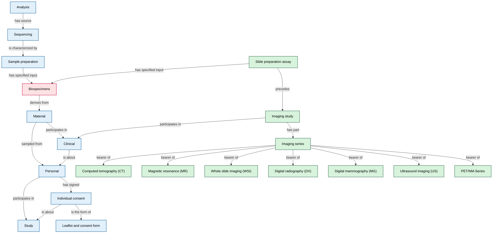

# Biobank Biosample and Data Integration Metadata Schema (BBDIMS)

This metadata schema is an extension of the [FAIR Genomes Metadata Schema](https://github.com/fairgenomes/fairgenomes-semantic-model) ([van der Velde et al., 2022](https://www.nature.com/articles/s41597-022-01265-x)) and its nine core modules. Tailored for the Czech national biobank metadata catalogue, it extends the original sequencing focus by incorporating dedicated modules for physical biospecimen management, alongside radiological and whole slide imaging (WSI) data linked directly to biosamples and their donors.



## Explore

Discover the full schema at the [interactive overview](generated/markdown/fairgenomes-semantic-model.md). 

## Source

The source of the schema is located at [fair-genomes.yml](fair-genomes.yml). The reference lookup lists are available at [lookups](lookups).

## Outputs

Representations of the schema for specific systems/users are generated from the schema. The following outputs are available:

#### Electronic Data Capture (EDC) systems

- MOLGENIS EMX2 database setup at [molgenis-emx2](generated/molgenis-emx2).

#### Resource Description Framework (RDF)

- Application ontology at [ontology](generated/ontology).
- Resources for new terms at [resource](generated/resource).

#### Documentation

- Interactive overview at [markdown](generated/markdown). View it [here](generated/markdown/fairgenomes-semantic-model.md).
- Typesetted LaTeX/PDF at [latex](generated/latex) and [pdf](derived/pdf). View it [here](derived/pdf/fair-genomes.pdf).


## Technical notes

#### Using an international list of institutes

The Research Organization Registry (https://ror.org/) provides a unique identifier for every research organization in the world.
The 2021-09-23 ROR Data release (see https://zenodo.org/communities/ror-data) has been transformed in a FAIR Genomes compatible lookup list.
This list, available at [InstitutesROR.txt](lookups/InstitutesROR.txt), can be used to supplement or replace the default [Institutes.txt](lookups/Institutes.txt).
The ROR institute data is currently not generated into apps because everything would become much bigger and slower than necessary under most circumstances.

#### FAIR Genomes YAML format

The YAML format used to contain the FAIR Genomes schema is documented at [YamlFormat.md](YamlFormat.md).

#### RDF formats

The FAIR Genomes application ontology [TTL files](generated/ontology) can be converted to other RDF serialization formats including OWL-XML, RDF-XML, RDF-JSON, JSON-LD, N-Triples, TriG, TriX, Thrift, Manchester syntax and Functional syntax using [Ontology Converter](https://github.com/sszuev/ont-converter/releases/tag/v1.0).

For example, conversion to OWL-XML can be accomplished by running: 
```
java -jar ont-converter.jar -i /path/to/fairgenomes-semantic-model/generated/ontology/fair-genomes.ttl -if TURTLE -o fair-genomes.owl -of OWL_XML
```


#### Release SOP

1. Set correct date, version number and release type in YAML file.
2. Generate outputs (by running Main.java).
3. Validate implementations:
    - Run MOLGENIS setup script
    - Import application ontology into GraphDB
    - Check Markdown rendering
4. Update PDF (run toPDF.sh in generated/latex).
5. Update version in [sys_StaticContent.tsv](misc/molgenis/other/sys_StaticContent.tsv).
6. Update version in [pom.xml](pom.xml).
7. Create a new Excel file at [misc/excel](misc/excel).
8. Make commits and push to fork.
9. Create Github release on main.
10. Prepare for further development: increment version in [fair-genomes.yml](fair-genomes.yml) and set to SNAPSHOT. Also update [pom.xml](pom.xml) and [sys_StaticContent.tsv](misc/molgenis/other/sys_StaticContent.tsv).
11. Update to new SNAPSHOT version in outputs by running Main.java.

#### MOLGENIS-EMX2

To upload to molgenis-emx2, make a zip of the generated/molgenis-emx2 and upload.
